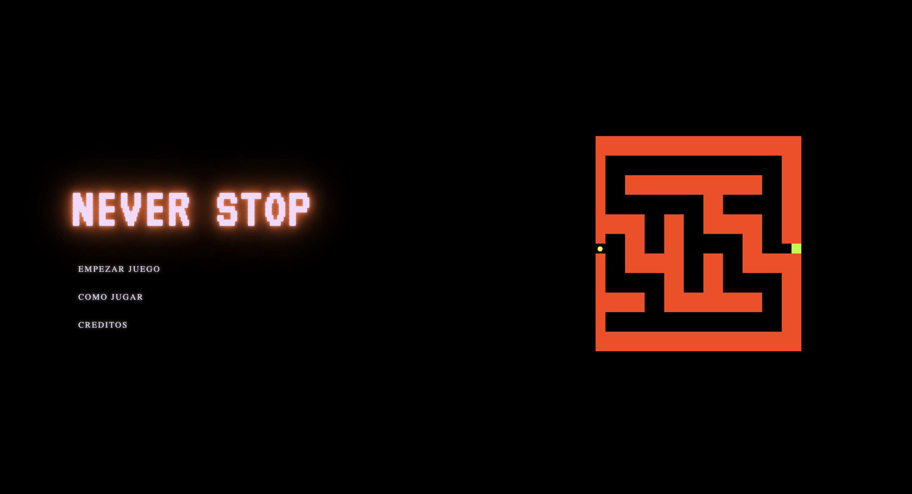
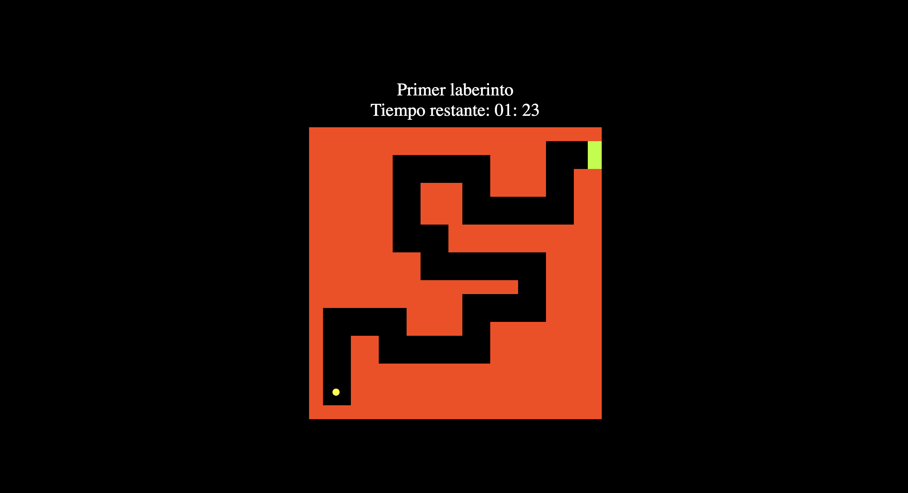
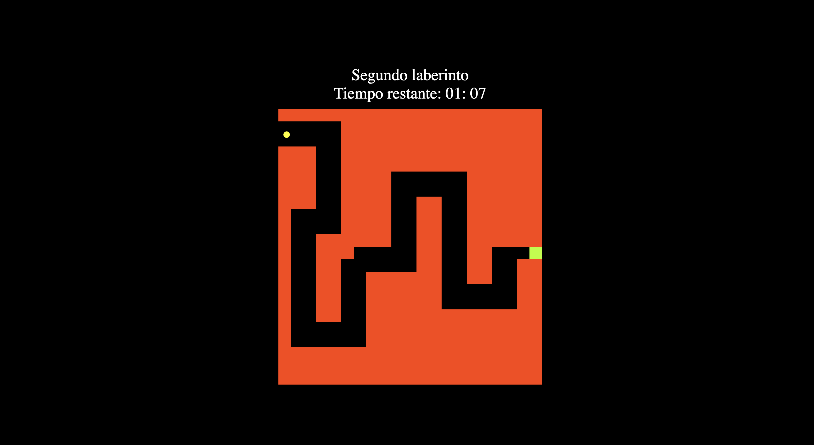
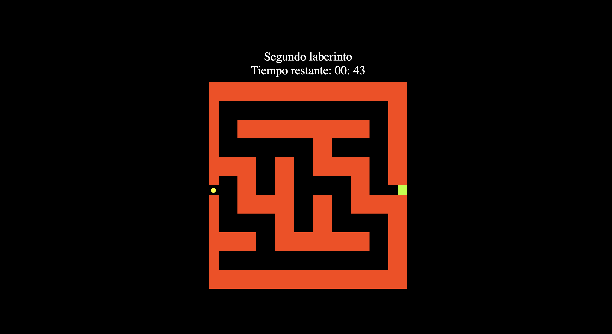
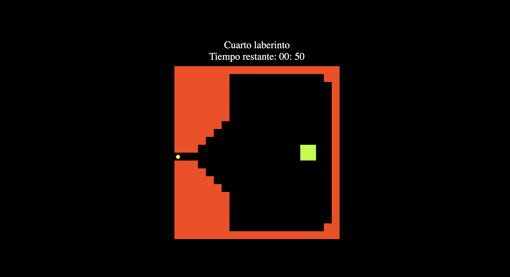

# Never Stop

## ¿Serás capaz de superar los cuatro niveles antes de que se agote el tiempo?

Te presentamos **Never Stop**, un juego inspirado en el mítico *El laberinto del Exorcista*, en el que pondrás a prueba tus habilidades, reflejos y precisión. ¿Aceptas el desafío?

### ¿Cómo empezar a jugar?

Para iniciar el juego, necesitarás instalar la extensión **Live Server** en Visual Studio Code. Una vez instalada, abre el archivo `index.html` y selecciona la opción **Open with Live Server**.

¡Suerte!

